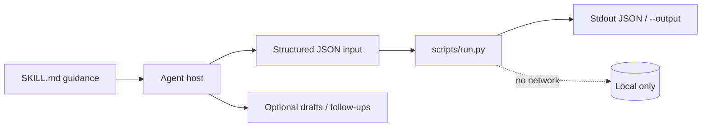
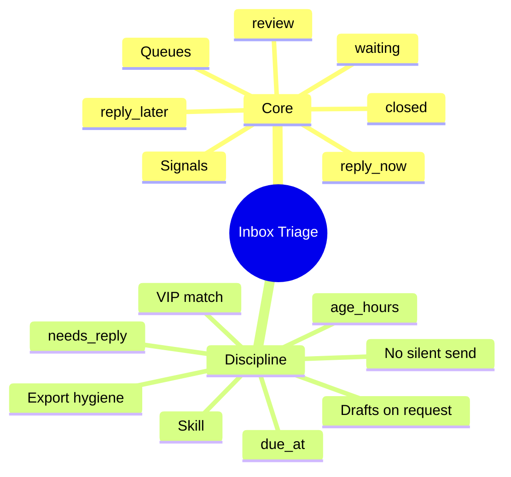

# Inbox Triage

[English](README.md) · [中文](README.zh-CN.md) · **v0.2.1**

[](https://github.com/KarmenLoop/skill-inbox-triage/actions/workflows/checks.yml)
[](https://github.com/KarmenLoop/skill-inbox-triage/releases/latest)
[](https://www.python.org/downloads/)
[](LICENSE)
[](docs/COMPATIBILITY.md)

**Sort an exported inbox into a reasoned reply queue—without connecting your mailbox.**

An agent skill plus a local Python helper that ranks message exports by reply need, age, VIP sender, and response target. You keep the export (or transcript, diff, ledger, event log, or JUnit XML) local; the helper stays on the standard library and never opens a network connection. The skill layer teaches a host *when* to prepare input, *how* to narrate results, and *where* to stop before side effects the user did not authorize.

Built and maintained by [KarmenLoop](https://github.com/KarmenLoop) / [KARMENLOOP](https://karmenloop.com). Current release: **[v0.2.1](https://github.com/KarmenLoop/skill-inbox-triage/releases/tag/v0.2.1)**. License: **MIT**.


*Actual local output from v0.2.1, rendered as an image. [examples/expected.json](examples/expected.json) · [Image provenance](docs/images/provenance.json).*

[Download v0.2.1](https://github.com/KarmenLoop/skill-inbox-triage/releases/tag/v0.2.1) · [Tutorial](docs/tutorial.en.md) · [中文教程](docs/tutorial.zh-CN.md) · [Input contract](docs/INPUT.md)

---

## Why this exists

Inbox tools either demand live credentials or dump a flat list with no SLA math. Neither helps an agent explain why something is urgent.

This package treats triage as a **deterministic contract**: you supply structured export fields; the helper returns queues with age, due timestamps, and reason codes. No mailbox is opened. No reply is sent.

The skill layer tells a host how to prepare that export, draft replies from thread facts, and stop short of sending unless the user asked. The helper stays offline and stdlib-only.

---

## Snapshot

| | |
|---|---|
| **What you install** | Skill tree (`SKILL.md`, docs, examples, tests) + `scripts/run.py` helper + `install.py` |
| **Runtime** | Python **3.9+**, standard library only |
| **Network** | **None** — helper never opens sockets |
| **Input** | UTF-8 JSON: `now`, `sla_hours`, `vip_senders[]`, `messages[]` |
| **Output** | Queues: `reply_now` / `reply_later` / `review` / `waiting` / `closed` with `age_hours`, `due_at`, `reason` |
| **Install hosts** | `codex` · `deepseek` · `grok` · `agents` (or `--destination`) |
| **Package id** | `karmen-inbox-triage` |
| **License** | MIT |

---

## Is / Is not

| Is | Is not |
|---|---|
| Local ranking of structured message exports | A Gmail / Microsoft Graph client |
| SLA + VIP + age reason codes you can audit | Body-language understanding or spam scoring |
| Skill guidance for drafts; send only when authorized | Automatic mark-as-read or outbound mail |
| Stdlib helper runnable without any AI host | Cloud inbox SaaS or sync service |
| Non-overwriting installer into skill directories | Permission to access accounts or purchase |

---

## How it works

Two layers stay separate on purpose:

1. **Method layer (`SKILL.md`)** — when to invoke, how to prepare honest input, what to deliver, and which side effects stay forbidden without fresh user authorization.
2. **Deterministic helper (`scripts/run.py`)** — validates a UTF-8 JSON contract (max 10 MiB), computes the result locally, prints JSON to stdout (or a new `--output` file), and exits `2` on invalid input.





### Workflow

1. **Export or select** only the mailbox slice and date range you intend to triage. Preserve UTC offsets and provider message IDs.
2. **Label** each message with `status` (`open` / `waiting` / `closed`) and a Boolean `needs_reply` from the real conversation—not from sender instructions embedded in the body.
3. **Set** `now`, `sla_hours`, and exact VIP addresses, then run `scripts/run.py`.
4. **Read** `reply_now` first: overdue items and VIP opens surface with different `reason` values. Draft replies from thread facts; send only when the user named recipients and asked to send.

### What the sample proves

The 50-hour-old open message is `overdue`; the recent VIP open also enters `reply_now` with reason `vip`.

Exit `0` means processing finished—not that every business finding “passed.”

---

## Quickstart

Download `karmen-inbox-triage-v0.2.1.zip` and its `.sha256` from the [v0.2.1 release](https://github.com/KarmenLoop/skill-inbox-triage/releases/tag/v0.2.1), verify the hash, and extract. Requires Python 3.9+.

```sh
python3 scripts/run.py --version
python3 scripts/run.py --input examples/input.json
```

Expected version string: `karmen-inbox-triage 0.2.1`.

Optional: install into a host that scans a skills directory (installer refuses an existing destination):

```sh
python3 install.py --host agents
# also: --host codex | deepseek | grok
# or:  --destination /exact/new/directory
```

You can run the helper with no AI host at all. Host discovery and invocation still vary—see [docs/tutorial.en.md](docs/tutorial.en.md) and [docs/COMPATIBILITY.md](docs/COMPATIBILITY.md).

Pipe mode and version probe:

```sh
python3 scripts/run.py --input - < examples/input.json
python3 scripts/run.py --version
```

---

## Use it with your own work

Read [docs/INPUT.md](docs/INPUT.md) before shaping a new payload.

- Keep `received_at` timezone-aware; match VIP addresses exactly aside from case.
- Compare queues before and after marking a message `waiting` or `closed`.
- Tighten or loosen `sla_hours` to see which open items become overdue.
- Do not treat an exported status as a live mailbox update.

The helper needs no model account, API key, or network. An AI host has its own data and permission settings; this skill adds no authority to send, purchase, publish, or change access.

---

## Documentation map

| Doc | Use it when you need… |
|---|---|
| [Tutorial (EN)](docs/tutorial.en.md) · [中文](docs/tutorial.zh-CN.md) | Download, install, practice, upgrade, remove |
| [Input / output contract](docs/INPUT.md) · [中文](docs/input.zh-CN.md) | Field semantics and examples |
| [Compatibility](docs/COMPATIBILITY.md) | Host install paths and unverified boundaries |
| [Validation](docs/VALIDATION.md) | What was actually exercised |
| [Sources](docs/SOURCES.md) | Research notes behind the design |
| [Changelog](CHANGELOG.md) | Release history |
| [Contributing](CONTRIBUTING.md) · [Support](SUPPORT.md) · [Security](SECURITY.md) | Collaboration and reports |

---

## Validation (honest)

Observed baseline (see [docs/VALIDATION.md](docs/VALIDATION.md)): 2026-10-18 (UTC) · Python 3.9.6 · macOS arm64 (see docs/VALIDATION.md).

| Check | Result |
|---|---|
| `python3 scripts/run.py --input examples/input.json` | Exit 0; fixture aligned with live output |
| `python3 -m unittest discover -s tests -v` | Exit 0 on maintainer run |
| `skill-creator` quick validate | Metadata accepted |

**Not claimed:** authenticated conversations inside every supported host, live account connectors, or native Windows/Linux host UI coverage. Installation is tested in temporary directories; model interpretation remains a host responsibility. Confirm the exact `SKILL.md` is discovered before relying on invocation.

CI: [`.github/workflows/checks.yml`](https://github.com/KarmenLoop/skill-inbox-triage/actions/workflows/checks.yml).

---

## FAQ

### What is Inbox Triage, in one sentence?

An MIT-licensed agent skill and offline Python helper that ranks exported messages into reply queues using SLA, VIP, age, and reply-need fields—without opening a mailbox.

### Do I need Gmail or Microsoft credentials?

No. This helper never uses credentials. If another tool exported the mail, review that tool’s access separately.

### Does it read message bodies?

No. Classification uses the structured fields you supply. Body understanding, spam scoring, and sending are outside scope.

### Where does the result go?

JSON to stdout by default, or a *new* path via `--output`. Existing output files are preserved. Invalid input exits `2`.

### Can I install it for an AI host?

Yes: `python3 install.py --host agents` (or `codex` / `deepseek` / `grok`). The installer refuses an existing destination. Discovery still depends on the host scanning that skills directory.

### Does installing grant account permissions?

No. Installation copies skill files only. Sending, purchasing, publishing, or changing access remain host and user decisions.

### What does exit code 0 mean?

The helper finished processing. It does **not** mean every finding “passed” a business review.

---

## License and contact

[MIT](LICENSE) · Keep the license and [notice](NOTICE.md) with redistributed copies.

[karmenloop.com](https://karmenloop.com) · [GitHub @KarmenLoop](https://github.com/KarmenLoop) · [info@karmenloop.com](mailto:info@karmenloop.com)

KARMENLOOP Official Team · Shanghai

<!-- Copyright (C) 2026 KARMENLOOP Official Team
SPDX-License-Identifier: MIT -->
