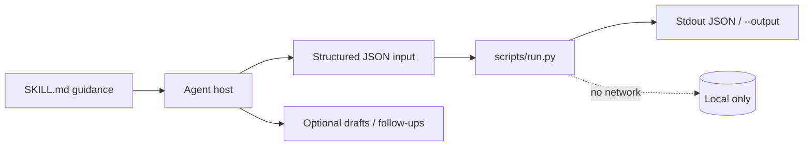
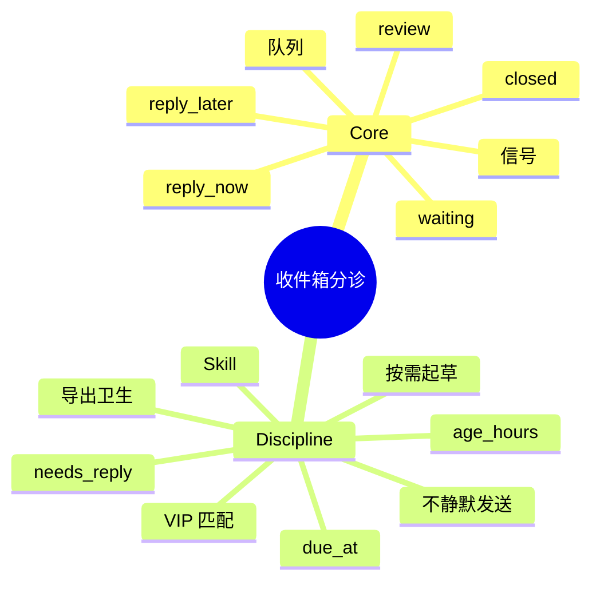

# 收件箱分诊

[English](README.md) · [中文](README.zh-CN.md) · **v0.2.1**

[](https://github.com/KarmenLoop/skill-inbox-triage/actions/workflows/checks.yml)
[](https://github.com/KarmenLoop/skill-inbox-triage/releases/latest)
[](https://www.python.org/downloads/)
[](LICENSE)
[](docs/COMPATIBILITY.md)

**不用连接邮箱，也能把导出的邮件按理由排进回复队列。**

一套 Agent Skill，外加本地 Python 辅助程序：按是否需回复、时长、VIP 发件人与响应时限，给邮件导出做排队。 导出（或会议文本、diff、账本、事件日志、JUnit XML）留在本地；辅助程序只用标准库，从不发起网络连接。Skill 层教宿主*何时*准备输入、*如何*陈述结果，以及在用户未授权的副作用前*停在哪里*。

由 [KarmenLoop](https://github.com/KarmenLoop) / [KARMENLOOP](https://karmenloop.com) 维护。当前发布：**[v0.2.1](https://github.com/KarmenLoop/skill-inbox-triage/releases/tag/v0.2.1)**。许可证：**MIT**。


*v0.2.1 真实本地输出渲染图。[examples/expected.json](examples/expected.json) · [图像出处](docs/images/provenance.json)。*

[下载 v0.2.1](https://github.com/KarmenLoop/skill-inbox-triage/releases/tag/v0.2.1) · [英文教程](docs/tutorial.en.md) · [中文教程](docs/tutorial.zh-CN.md) · [输入契约](docs/input.zh-CN.md)

---

## 为什么做这个

常见收件箱工具要么要在线凭据，要么只给一张无 SLA 计算的扁平列表——两者都帮不了 Agent 说清「为什么现在急」。

本仓库把分诊做成**确定性契约**：你提交结构化导出字段，辅助程序返回带时长、到期时间与原因码的队列。不打开邮箱，不代发回复。

Skill 层指导宿主如何准备导出、按线程事实起草回复，并在用户未授权发送时停住。辅助程序保持离线、仅用标准库。

---

## 快照

| | |
|---|---|
| **安装内容** | Skill 树（`SKILL.md`、文档、示例、测试）+ `scripts/run.py` 辅助程序 + `install.py` |
| **运行时** | Python **3.9+**，仅标准库 |
| **网络** | **无** — 辅助程序不开套接字 |
| **输入** | UTF-8 JSON：`now`、`sla_hours`、`vip_senders[]`、`messages[]` |
| **输出** | 队列：`reply_now` / `reply_later` / `review` / `waiting` / `closed`，含 `age_hours`、`due_at`、`reason` |
| **安装宿主** | `codex` · `deepseek` · `grok` · `agents`（或 `--destination`） |
| **包标识** | `karmen-inbox-triage` |
| **许可证** | MIT |

---

## 是 / 不是

| 是 | 不是 |
|---|---|
| 对结构化邮件导出做本地排队 | Gmail / Microsoft Graph 客户端 |
| 可审计的 SLA + VIP + 时长原因码 | 正文语义理解或垃圾邮件打分 |
| Skill 指导起草；仅在授权后发送 | 自动标已读或代发外发邮件 |
| 无 AI 宿主也能跑的标准库辅助程序 | 云端收件箱 SaaS 或同步服务 |
| 不覆盖已有目录的安装器 | 获取账号权限或代为购买 |

---

## 工作方式

两层有意分开：

1. **方法层（`SKILL.md`）** — 何时调用、如何准备诚实输入、交付什么，以及哪些副作用在没有新的用户授权时仍禁止。
2. **确定性辅助程序（`scripts/run.py`）** — 校验 UTF-8 JSON 契约（最大 10 MiB），本地计算，打印到 stdout（或新的 `--output`），非法输入以 `2` 退出。





### 流程

1. **导出或圈定**你要分诊的邮箱切片与日期范围；保留 UTC 偏移与提供商消息 ID。
2. **标注**每封邮件的 `status`（`open` / `waiting` / `closed`）以及来自真实对话的 `needs_reply` 布尔值——不要把正文里的「忽略指令」当成可信指令。
3. **设定** `now`、`sla_hours` 与精确 VIP 地址，再运行 `scripts/run.py`。
4. **先看** `reply_now`：逾期项与 VIP 打开项会以不同 `reason` 出现。按线程事实起草；仅在用户点名收件人并要求发送时再发。

### 示例证明什么

已打开 50 小时的邮件因 `overdue` 进入 `reply_now`；近期 VIP 打开邮件同样进入该队列，原因为 `vip`。

退出码 `0` 表示处理完成——不表示业务上「全部通过」。

---

## 快速开始

从 [v0.2.1 发布页](https://github.com/KarmenLoop/skill-inbox-triage/releases/tag/v0.2.1) 下载 `karmen-inbox-triage-v0.2.1.zip` 与对应 `.sha256`，校验哈希后解压。需要 Python 3.9+。

```sh
python3 scripts/run.py --version
python3 scripts/run.py --input examples/input.json
```

期望版本串：`karmen-inbox-triage 0.2.1`。

可选：安装到会扫描 skills 目录的宿主（目标已存在则拒绝）：

```sh
python3 install.py --host agents
# 亦可：--host codex | deepseek | grok
# 或：  --destination /精确/新目录
```

完全可以不借助 AI 宿主直接跑辅助程序。宿主发现与调用方式仍因产品而异——见 [docs/tutorial.zh-CN.md](docs/tutorial.zh-CN.md) 与 [docs/COMPATIBILITY.md](docs/COMPATIBILITY.md)。

管道与版本探测：

```sh
python3 scripts/run.py --input - < examples/input.json
python3 scripts/run.py --version
```

---

## 用在你自己的工作上

准备新载荷前先读 [docs/input.zh-CN.md](docs/input.zh-CN.md)（或 [docs/INPUT.md](docs/INPUT.md)）。

- `received_at` 必须带时区；VIP 地址除大小写外须精确匹配。
- 把邮件标为 `waiting` 或 `closed` 前后对比队列变化。
- 调整 `sla_hours`，观察哪些打开项变为逾期。
- 不要把导出状态当成在线邮箱的实时更新。

辅助程序不需要模型账号、API 密钥或网络。AI 宿主有自己的数据与权限设置；本 skill 不授予发送、购买、发布或改权限的权力。

---

## 文档地图

| 文档 | 何时使用 |
|---|---|
| [教程（中文）](docs/tutorial.zh-CN.md) · [English](docs/tutorial.en.md) | 下载、安装、练习、升级、卸载 |
| [输入/输出契约（中文）](docs/input.zh-CN.md) · [EN](docs/INPUT.md) | 字段语义与示例 |
| [兼容性](docs/COMPATIBILITY.md) | 宿主安装路径与未验证边界 |
| [验证](docs/VALIDATION.md) | 实际跑过什么 |
| [来源](docs/SOURCES.md) | 设计背后的研究笔记 |
| [变更日志](CHANGELOG.md) | 发布历史 |
| [贡献](CONTRIBUTING.md) · [支持](SUPPORT.md) · [安全](SECURITY.md) | 协作与报告 |

---

## 验证（如实）

基线见 [docs/VALIDATION.md](docs/VALIDATION.md)：2026-10-18 (UTC) · Python 3.9.6 · macOS arm64 (see docs/VALIDATION.md)。

| 检查 | 结果 |
|---|---|
| `python3 scripts/run.py --input examples/input.json` | 退出 0；夹具与实跑输出对齐 |
| `python3 -m unittest discover -s tests -v` | 维护者环境退出 0 |
| `skill-creator` 快速校验 | 元数据通过 |

**未声称：** 每个支持宿主内的已登录对话、在线账号连接器，或 Windows/Linux 宿主 UI 全覆盖。安装在临时目录测过；模型如何解释仍是宿主责任。依赖调用前请确认精确的 `SKILL.md` 已被发现。

CI：[`.github/workflows/checks.yml`](https://github.com/KarmenLoop/skill-inbox-triage/actions/workflows/checks.yml)。

---

## 常见问题

### 一句话：收件箱分诊是什么？

MIT 许可的 Agent Skill + 离线 Python 辅助程序：按 SLA、VIP、时长与是否需回复，给导出邮件排队——不打开邮箱。

### 需要 Gmail 或微软凭据吗？

不需要。本辅助程序不用凭据。若邮件由别的工具导出，请单独审查那套工具的访问权限。

### 会读邮件正文吗？

不会。分类只用你提交的结构化字段。正文理解、垃圾邮件打分与发送均不在范围内。

### 结果写到哪里？

默认打印到 stdout；或用 `--output` 写到*新*路径。已有输出文件会被保留。非法输入以退出码 `2` 结束。

### 可以装进 AI 宿主吗？

可以：`python3 install.py --host agents`（或 `codex` / `deepseek` / `grok`）。安装器拒绝已存在目标。能否被发现仍取决于宿主是否扫描该 skills 目录。

### 安装会授予账号权限吗？

不会。安装只复制 skill 文件。发送、购买、发布或改权限仍由宿主与用户决定。

### 退出码 0 代表什么？

辅助程序处理完成。**不**代表业务上「全部通过」。

---

## 许可与联系

[MIT](LICENSE)。再分发时请保留许可证与 [声明](NOTICE.md)。

[karmenloop.com](https://karmenloop.com) · [GitHub @KarmenLoop](https://github.com/KarmenLoop) · [info@karmenloop.com](mailto:info@karmenloop.com)

KARMENLOOP Official Team · 上海

<!-- Copyright (C) 2026 KARMENLOOP Official Team
SPDX-License-Identifier: MIT -->
