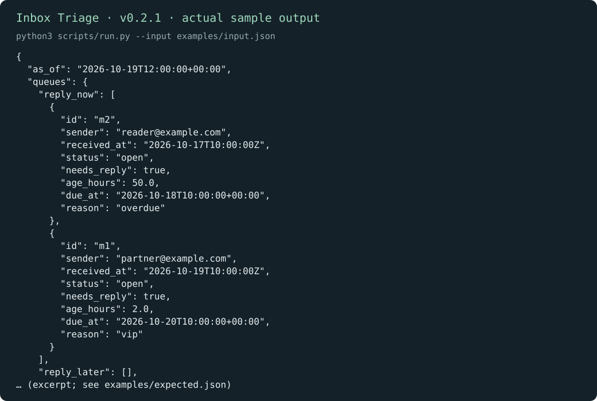

# Inbox Triage · 收件箱分流

[English](README.md) | 简体中文

不用连接邮箱，也能先把导出的邮件排出回复顺序。工具根据邮件时间、回复状态、重要联系人和响应时限，说明哪些事项需要关注。

[下载 v0.2.1](https://github.com/KarmenLoop/skill-inbox-triage/releases/tag/v0.2.1) · [完整教程](docs/tutorial.zh-CN.md) · [输入参考](docs/input.zh-CN.md) · [反馈问题](https://github.com/KarmenLoop/skill-inbox-triage/issues)

## 能做什么

样例中 50 小时前的邮件已逾期；较新的重要联系人邮件也进入 reply_now，两者 reason 不同。

工具不读取邮箱、不发送回复。结果是否最新，取决于你提供的导出记录和状态。



*图片来自 v0.2.1 的真实本地输出，采用英文键名；[完整结果](examples/expected.json) · [图片来源记录](docs/images/provenance.json)。*

## 开始使用

在发行页下载 `karmen-inbox-triage-v0.2.1.zip` 与对应 `.sha256` 文件，核对哈希后解压。在解压目录中使用 Python 3.9 或更新版本：

```sh
python3 scripts/run.py --version
python3 scripts/run.py --input examples/input.json
```

预期版本：`karmen-inbox-triage 0.2.1`。样例中 50 小时前的邮件已逾期；较新的重要联系人邮件也进入 reply_now，两者 reason 不同。

如果宿主读取 `~/.agents/skills`，可安装完整技能：

```sh
python3 install.py --host agents
```

目标目录已存在时安装器会拒绝覆盖。宿主发现和调用方式可能不同，见[安装与实践教程](docs/tutorial.zh-CN.md)。不使用 AI 宿主也能直接运行本地工具。

## 用于自己的任务

填写本次检查时间 now 与 sla_hours；received_at 要有时区，needs_reply 用布尔值，状态为 open、waiting 或 closed。VIP 地址除大小写外需准确匹配。

把邮件改为 waiting 或 closed 后比较队列，再调整响应时限检查逾期变化。导出数据中的状态不等于已经更新真实邮箱。

准备新输入前可查看[字段约定](docs/input.zh-CN.md)。工具只依赖 Python 标准库，本身不需要模型账号、API 密钥或网络。使用 AI 宿主时，宿主有自己的数据与权限设置。

## 常见问题

**需要 Gmail 或微软账号凭据吗？** 本工具不使用账号凭据。如果通过其他工具导出邮件，需要单独检查该工具的访问权限。

**结果保存在哪里？** 默认向终端输出 JSON；使用 `--output` 时只创建新文件，已有输出文件会保留。工具只读取提交的记录和输入约定中明确列出的本地路径。

## 文档与支持

- [下载、安装、配置、练习、升级与卸载](docs/tutorial.zh-CN.md)
- [输入输出约定](docs/input.zh-CN.md)与[兼容性说明](docs/COMPATIBILITY.md)（英文参考）
- [更新记录](CHANGELOG.md)、[参与贡献](CONTRIBUTING.md)、[支持](SUPPORT.md)和[安全反馈](SECURITY.md)

## 许可证

[MIT](LICENSE)。再分发时保留许可证和[声明](NOTICE.md)。由 [KarmenLoop](https://karmenloop.com) 维护。
